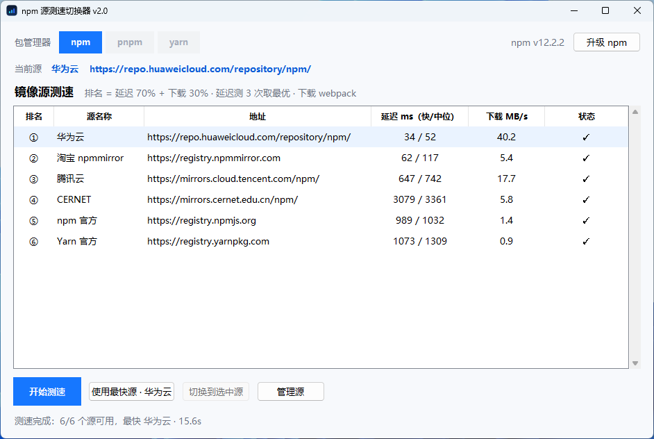
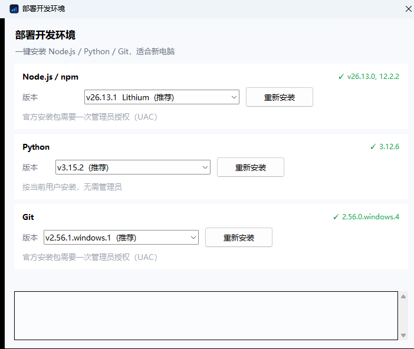

# npm 源测速切换器 2.3

[](https://github.com/NANYAN-01/Quick-npm-ok/releases/latest)
[](https://github.com/NANYAN-01/Quick-npm-ok/actions/workflows/build.yml)
[](https://www.python.org/)
[](LICENSE)

一个 Windows 小工具：**测所有 npm 镜像源的延迟与下载速度、综合排名、一键切换**。
支持 **npm / pnpm / yarn**，还能给新电脑**一键装好 Node.js、Python 和 Git**。

> 让每次 `npm install` 都快一点。

单文件 exe（约 11 MB），不依赖本机 Python 环境。

## 下载与运行

到 [Releases](https://github.com/NANYAN-01/Quick-npm-ok/releases/latest) 下载最新的 `Quick-npm-ok-v<版本>.exe`，双击即可运行。
首次运行若被 SmartScreen 拦截，点「更多信息 → 仍要运行」。

## 界面





## 功能

| 功能 | 说明 |
|---|---|
| 一键测速 | 延迟测 3 次取最快/中位（含 DNS + TCP + TLS）；再下载一个 tarball 算真实速度 |
| 综合排名 | 延迟 70% + 下载 30% 归一化打分，① ② ③ … 排序，第一名绿色高亮 |
| 一键切换 | 写入对应包管理器的用户级配置；双击表格行也可以 |
| 使用最快源 | 测速后按钮直接显示第一名，点一下切换 |
| 多包管理器 | 自动检测 npm / pnpm / yarn，未安装的置灰 |
| 管理源 | 应用内添加 / 修改 / 删除 / 恢复默认，立即生效并持久化 |
| 升级 npm | 显示当前 / 最新版本，一键升级，带实时日志；权限不足可「以管理员身份升级」 |
| 部署环境 | 一键安装 Node.js / Python / Git，版本可选，带下载进度与日志 |
| 同步检测 | 「同步」列显示各镜像的 npm 版本，落后最新版标 ⚠ |
| 代理 | 自动读取 Windows 系统代理或 `HTTPS_PROXY`，也可手动指定 |
| 托盘 | 关闭窗口最小化到托盘，右键「测速并切到最快源」 |
| 结果缓存 | 下次打开直接显示上次排名，并标注多久之前测的 |
| 导出 / 历史 | 测速结果导出 CSV；历史记录保存每次的最快源与可用数 |
| 自动更新 | 启动时检查 GitHub Releases，下载后退出即替换 |
| 作用域源 | 为 `@company` 之类作用域单独指定 registry |
| 项目级 .npmrc | 只影响选定目录，不改全局配置 |
| 中英双语 | 「设置」里切换界面语言 |

### 排名算法

对可用的源：

```
延迟得分 = 最小中位延迟 / 本源中位延迟
下载得分 = 本源下载速度 / 最大下载速度
综合分   = 0.7 × 延迟得分 + 0.3 × 下载得分       // 0 ~ 1
```

按综合分从高到低排名，失败或无响应的源排在最后。选中某行时，底部会显示该源的排名和综合分。

### 包管理器说明

- **npm**：`npm config set registry <url>`，写入 `%USERPROFILE%\.npmrc`
- **pnpm**：`pnpm config set registry <url>`（与 npm 共用 `.npmrc`，设置后也会影响 npm）
- **yarn**：自动区分经典版（`yarn config set registry`）和 Berry（`npmRegistryServer`）

### 部署开发环境

「环境…」对话框里三行，各自选版本后点安装：

| 工具 | 安装方式 | 权限 | 说明 |
|---|---|---|---|
| Node.js | 官方 MSI，静默安装 | 需要一次 UAC | 装完同时得到 npm |
| Python | 官方安装器 `/quiet InstallAllUsers=0 PrependPath=1` | 不需要 | 按当前用户安装，PATH 只加用户级 |
| Git | 官方安装器 `/VERYSILENT` | 需要一次 UAC | 装完 `git` 可直接用 |

版本目录来自各家的官方元数据；Python 会自动跳过「只有源码包、没有 Windows 安装包」的安全修复版。
下载顺序是 npmmirror → 华为云 → 官方站，遇到 404 或不可达会自动换下一个，Node.js 还会校验 SHA256。

> 装完新开的终端才能识别新 PATH；本工具会立刻刷新自己进程的环境变量。
> 卸载请用「设置 → 应用」里对应的 Node.js / Python / Git 条目。

## 源码运行

```bash
python npm_mirror_tool.py             # 打开界面
python npm_mirror_tool.py --selftest out.json   # 无界面测速，结果写 JSON
python npm_mirror_tool.py --version
```

仅依赖 Python 标准库（tkinter）。

## 开发

```bash
python -m unittest discover -s tests -v   # 40 个单元测试，不联网
python tools/smoke_ui.py                 # 界面冒烟测试：逐个打开对话框
python -m pyflakes app tools tests       # 静态检查
```

目录结构：

```
app/
  __init__.py   版本号、应用信息
  core.py       配置、代理、测速、排名、包管理器操作
  deploy.py     Node.js / Python / Git 的版本目录、下载与安装
  ui.py         主窗口与所有对话框（tkinter）
  tray.py       托盘图标（纯 ctypes）
  updater.py    检查更新、下载、退出后替换自身
  i18n.py       中英文字符串表
tests/          单元测试
tools/          截图、界面冒烟测试、提示条预览
```

## 重新打包 exe

需要 Python 3.9+ 和 PyInstaller：

```bash
pip install pyinstaller
python build.py          # 或双击 build.bat
```

打包脚本会先生成 `app.ico`（9 个尺寸，16–256），再调用 PyInstaller 打成单文件。
想换成仪表盘样式的图标：`python make_icon.py --variant gauge` 后重新打包。

输出：`dist\npm源测速.exe`。推送到 `main` 分支时 GitHub Actions 也会自动构建并上传产物；
打 `v*` 标签则自动创建 Release。

## 配置文件

设置与源列表都在：

```
%APPDATA%\npm-mirror-tool\config.json
```

```json
{
  "language": "zh",
  "proxy": { "mode": "auto", "url": "" },
  "scope": { "mode": "user", "dir": "" },
  "tray": true,
  "autostart": false,
  "update_check": true,
  "sources": [
    { "name": "华为云", "url": "https://repo.huaweicloud.com/repository/npm/" }
  ]
}
```

同目录下还有 `history.jsonl`（历史记录）和 `last.json`（上次测速缓存）。
删掉 `config.json` 即恢复内置源与默认设置。可用环境变量 `NPM_MIRROR_TOOL_CONFIG_DIR` 覆盖配置目录（便于测试）。

## 命令行版

`npm-mirror-bench.mjs`（Node 18+）适合脚本 / CI：

```bash
node npm-mirror-bench.mjs --runs 3
node npm-mirror-bench.mjs --json
```

## 常见问题

- **SmartScreen 提示“未知发布者”**：exe 未做代码签名，点「更多信息 → 仍要运行」。
- **杀毒软件误报**：PyInstaller 单文件包偶尔被误报；可用 `--onedir` 打包或直接跑源码。
- **切换失败**：确认对应包管理器命令可用；写入的是用户级配置，不需要管理员。
- **pnpm 切换后 npm 也变了**：正常的，两者共用 `.npmrc`。
- **安装 Node.js 卡住**：UAC 提示可能在任务栏闪烁，点一下「是」。
- **装完仍提示找不到命令**：新开一个终端；本工具会自己刷新 PATH，其他程序需要重启。
- **发布包**：`npm publish` 前记得切回官方源。

## 已知限制

- 未做代码签名，SmartScreen 会提示；需要签名证书（约 ¥1000+/年）。
- Windows 上 Node.js / Git 是机器级安装，必然弹一次 UAC；这是选官方安装包的代价。
- 只支持 Windows（路径、注册表、托盘都是 Windows 实现）。

## GitHub 上的类似项目

| 项目 | 说明 |
|---|---|
| [Pana/nrm](https://github.com/Pana/nrm) | 最知名的 npm 源管理器（CLI），`nrm test` 可测速 |
| [YunYouJun/nnrm](https://github.com/YunYouJun/nnrm) | nrm 重写版，依赖更少 |
| [modern-magic/grm](https://github.com/modern-magic/grm) | Go 写的极简源管理器，单二进制 |
| [coderhsh/nrm-desktop](https://github.com/coderhsh/nrm-desktop) | 跨平台桌面版源管理器 |
| [fa1seut0pia/mirror-speed-test](https://github.com/fa1seut0pia/mirror-speed-test) | 中文镜像源测速工具（Web） |
| [Weidows/mirrorhub](https://github.com/Weidows/mirrorhub) | 多包管理器镜像测速与切换 |
| [open-services/public-registry-benchmarks](https://github.com/open-services/public-registry-benchmarks) | 公共 npm registry 基准数据 |

## 文件说明

| 文件 | 用途 |
|---|---|
| `npm_mirror_tool.py` | 程序入口（命令行参数、DPI、启动界面） |
| `app/` | 主程序包，见上文目录结构 |
| `tests/` | 单元测试（`python -m unittest discover -s tests`） |
| `tools/shot.py` | 按窗口标题截图（PrintWindow，可截被遮挡的窗口） |
| `tools/smoke_ui.py` | 界面冒烟测试 |
| `make_icon.py` | 生成 `app.ico` / `app.png`（纯标准库，9 个尺寸，可 `--variant gauge`） |
| `build.py` | 打包逻辑：生成图标 + PyInstaller |
| `build.bat` | 双击打包入口（转调 `build.py`） |
| `dist\npm源测速.exe` | 打包产物（本地产物，未纳入 git；发布版见 Releases） |
| `npm-mirror-bench.mjs` | 命令行测速脚本 |
| `npm源测速.bat` | 命令行脚本的 Windows 启动器 |
| `.github/workflows/build.yml` | CI：静态检查 + 测试 + 打包 + 打标签发版 |

## 许可证

[MIT](LICENSE) © 2026 NANYAN-01
